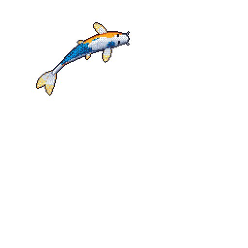

### Hi, I'm François 🤗

I'm a final-year AI student based in Paris.

My background is in deep learning, and I fundamentally believe the next big revolution will happen in the physical world.

I'm particularly interested in building adaptable robots. In a few years, I'd love to be contributing to robots that can assist in places like hospitals, and to be able to look back and feel proud of having built something actually useful.

I'm still finding my way into robotics, so most of what you'll find here comes from learning by building in my spare time. Yeah... turns out French unis make you take a **lot** of generalist courses.

### Stuff I've built

- **[egocentric-to-robot](https://github.com/K3YB04RD-w4rri0r/egocentric-to-robot)** · My first robotics project: training a simulated Panda arm using videos of me pushing a box.
- **[GAIA_experiments](https://github.com/K3YB04RD-w4rri0r/GAIA_experiments)** · Searching for binary asteroids in Gaia astrometry using PyTorch sequence models. This repository contains the code behind my first-author paper at the [NeurIPS 2026 Sim2Science workshop](https://openreview.net/forum?id=eRpIVMz0ti).
- **[Minecraft-RL-env](https://github.com/K3YB04RD-w4rri0r/Minecraft-RL-env)** · A reinforcement learning environment that lets agents such as PPO, SAC, and DQN interact with Minecraft through the Mineflayer API. (CPU-bound!)

### Right now

This year, I'll be working on reinforcement learning in simulation for RoboCup at CentraleSupélec.

I'm also looking for a 6-month internship in robot learning or ML research starting April 2027. I'd particularly love to work on problems involving reinforcement learning or world models.

Feel free to reach out! Always excited about building things with cracked people!

Outside of research and code, I run my school's AI club and used to fence competitively.

📫 **[francois.saintjean04@gmail.com](mailto:francois.saintjean04@gmail.com)**

<!--
**K3YB04RD-w4rri0r/K3YB04RD-w4rri0r** is a ✨ _special_ ✨ repository because its `README.md` (this file) appears on your GitHub profile.

Here are some ideas to get you started:

- 🔭 I’m currently working on ...
- 🌱 I’m currently learning ...
- 👯 I’m looking to collaborate on ...
- 🤔 I’m looking for help with ...
- 💬 Ask me about ...
- 📫 How to reach me: ...
- 😄 Pronouns: ...
- ⚡ Fun fact: ...
-->
